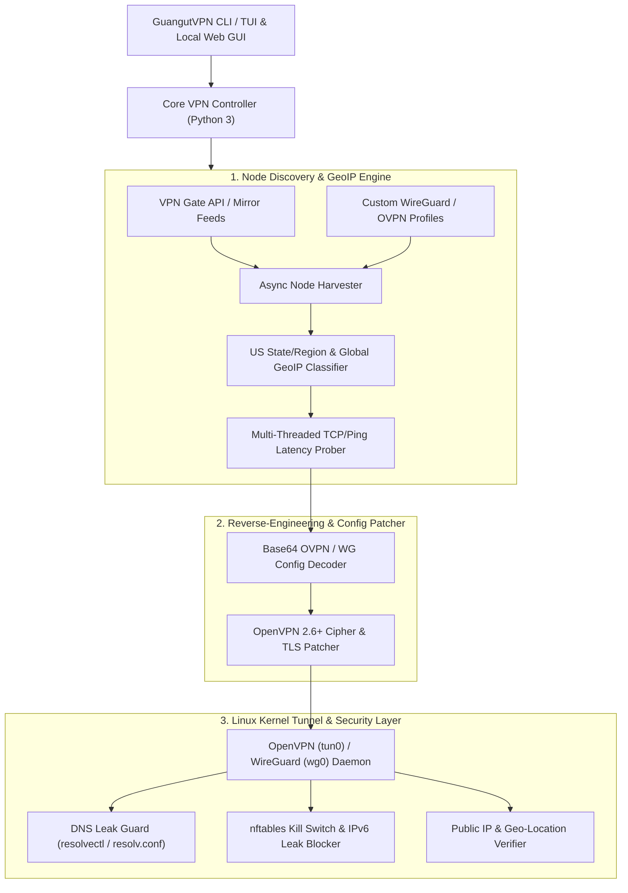

# GuangutVPN — Architecture & Engineering Plan (`vpnPlan.md`)

## 1. Platform Selection: Native Linux VPN vs. Chrome Extension

We chose a **Native Linux-Based VPN** (built on **OpenVPN** + **WireGuard** with an optional local GUI/TUI dashboard) over a Chrome Extension for the following technical reasons:

| Feature | Chrome Extension ("VPN") | Native Linux VPN (GuangutVPN) |
| :--- | :--- | :--- |
| **Traffic Scope** | Browser HTTP/HTTPS/SOCKS5 proxy only (`chrome.proxy`). Terminal (`curl`, `git`, `ssh`) and other apps bypass it. | **True Layer-3 Kernel Tunnel (`tun0` / `wg0`)**. Encrypts and routes **100% of system traffic** (browsers, terminal, apps, background daemons). |
| **UDP & WebRTC** | Easily leaks real IP via WebRTC or non-browser UDP sockets. | Captures all TCP, UDP, and ICMP packets at the Linux routing table level. |
| **DNS Security** | Subject to OS-level DNS fallback leaks. | Enforces strict tunnel-only DNS via `systemd-resolved` / `/etc/resolv.conf` lock + `nftables` firewall rules. |
| **Kill Switch** | Impossible if browser crashes or extension reloads. | Kernel-enforced `nftables` Kill Switch that blocks non-tunnel traffic if the VPN drops. |

---

## 2. Open-Source Foundation & Reverse-Engineering Strategy

Instead of paying for a commercial VPN or starting from scratch without servers, **GuangutVPN** combines and reverse-engineers three proven open-source ecosystems:

1. **Base Client & Harvester Reference (`sajadinmaker/vpnbox` & `Cypher-Monarch/CypherGate`)**:
   - Open-source Python Linux VPN clients that harvest live, volunteer-run and academic VPN relays from the **University of Tsukuba VPN Gate API** (`http://www.vpngate.net/api/iphone/`) and community WireGuard/OpenVPN feeds.
2. **Protocol & Config Reverse-Engineering (The OpenVPN 2.6+ / Debian 13 Fix)**:
   - **The Problem**: Most open-source free VPN scripts and raw `.ovpn` files fail on modern Linux (like **Debian 13 Trixie** with OpenVPN 2.6+) because legacy servers advertise `cipher AES-128-CBC` or `AES-256-CBC`, which OpenVPN 2.6 rejects by default (`OPTIONS ERROR: failed to negotiate cipher`), and use deprecated `tls-cipher` or missing key-direction parameters.
   - **Our Reverse-Engineering Fix**: GuangutVPN includes an automated **OVPN Binary/Config Patcher Engine** that inspects decoded Base64 `.ovpn` payloads in memory and injects:
     - `data-ciphers AES-256-GCM:AES-128-GCM:CHACHA20-POLY1305:AES-128-CBC:AES-256-CBC`
     - `data-ciphers-fallback AES-128-CBC`
     - Modernized TLS version constraints (`tls-version-min 1.0` where required by legacy relays) and explicit DNS leak prevention hooks.
3. **US Regional Geolocation & Multi-Country Engine**:
   - **Primary Mode (All-US & US Regional Targeting)**: Queries live US nodes and enriches each node's IP via GeoIP lookup (`ip-api.com` / `ipinfo.io` / local GeoIP cache) to classify US servers by **State, City, and Region** (e.g., *US-East: New York, Virginia, Florida*; *US-Central: Texas, Illinois*; *US-West: California, Washington, Oregon*).
   - **Secondary Mode (Global Country Selector)**: Allows switching to any available country worldwide (`JP`, `KR`, `GB`, `DE`, `CA`, `NL`, etc.) on demand.
   - **Custom / Self-Hosted WireGuard & OpenVPN Import**: Supports dropping in any custom `.conf` (WireGuard) or `.ovpn` profile (e.g., from ProtonVPN Free or self-hosted cloud nodes).

---

## 3. System Architecture



---

## 4. System Requirements (Target Environment: Debian GNU/Linux 13 Trixie)

### 4.1 Already Installed on Your Machine (Verified)
- **OS**: Debian GNU/Linux 13 (`trixie`)
- **Python**: `python3` (`/usr/bin/python3`) & `pip3` (`/usr/bin/pip3`)
- **Network Stack**: `iproute2` (`/usr/bin/ip`), `NetworkManager` (`/usr/bin/nmcli`), `nftables` (`/usr/sbin/nft`)
- **Utilities**: `curl`, `git`, `node`

### 4.2 Packages to Install via `apt`
To establish real kernel-level VPN tunnels, we need the userspace tunnel binaries installed:
```bash
sudo apt update && sudo apt install -y openvpn wireguard-tools openresolv python3-venv python3-rich python3-requests
```
*(Note: If you prefer using a Python `venv` inside `/home/yona/Projects/GuangutVPN`, `rich`, `requests`, and `textual`/`flask` will be installed cleanly in `.venv`.)*

### 4.3 Privileges Requirement
- Creating network interfaces (`tun0` / `wg0`), updating routing tables (`ip route`), and configuring `nftables` kill-switch rules require `sudo` / `root` privileges during tunnel activation and teardown.
- All server discovery, US region filtering, speed probing, and `.ovpn` patching run safely as your normal user (`yona`).

---

## 5. Core Features We Will Build in `/home/yona/Projects/GuangutVPN`

1. **US-First Smart Server Discovery (`us-all`, `us-east`, `us-central`, `us-west`, or specific US State/City)**:
   - Fetches live VPN nodes, filters for `CountryShort == "US"` by default, resolves exact US State & City coordinates, tests live TCP socket handshake latency (so dead servers are skipped immediately), and ranks them by speed and uptime score.
2. **Global Country Expansion (`--country <CODE>`)**:
   - Instant support for non-US countries (`JP`, `DE`, `GB`, `CA`, `KR`, `SG`, etc.) or listing all available countries dynamically.
3. **OpenVPN 2.6+ Auto-Patcher (`patcher.py`)**:
   - Automatically reverse-engineers and rewrites legacy `.ovpn` configs so they connect cleanly on Debian 13 without cipher, TLS, or routing errors.
4. **Auto-Failover & Connection Watchdog**:
   - If the top-ranked US server fails handshake within 12 seconds, GuangutVPN automatically rolls over to the next fastest verified US server until `tun0` is up.
5. **Kill Switch & DNS/IPv6 Leak Protection (`security.py`)**:
   - Configures `nftables` rules to prevent traffic leaks outside `tun0` and disables IPv6 leaks while connected, restoring original network state cleanly on disconnect.
6. **Interactive TUI / CLI + Optional Local Web Dashboard**:
   - Clean command-line interface (`guangut connect --us`, `guangut connect --us-region west`, `guangut connect --country JP`, `guangut status`, `guangut disconnect`) plus an interactive terminal dashboard showing live throughput, public IP verification, US state/city location, and connection timer.

