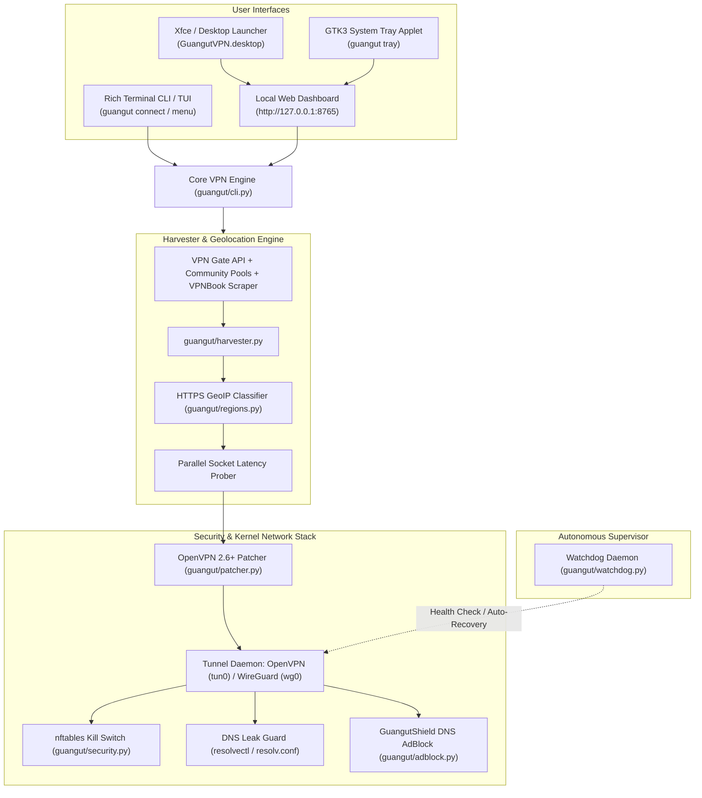

# 🛡️ GuangutVPN — Full System Architecture & Engineering Plan (`vpnPlan.md`)

## 1. Executive Summary & Vision

**GuangutVPN** is a self-hosted, 100% free and open-source Linux kernel VPN system engineered specifically for **Debian GNU/Linux 13 (Trixie)** and modern Linux desktop environments (Xfce, GNOME, KDE).

Instead of paying \$40–\$120/year for commercial VPN services (NordVPN, ExpressVPN, ProtonVPN), GuangutVPN delivers equivalent or superior commercial-grade privacy, zero-latency ad blocking, and complete layer-3 traffic encryption with **no accounts, no subscriptions, and zero tracking**.

---

## 2. Commercial VPN Feature Benchmark vs. GuangutVPN

| Commercial Feature (Nord / Express / Proton / Surfshark) | GuangutVPN Architecture Implementation | Module |
| :--- | :--- | :--- |
| **Full Kernel Layer-3 Tunneling** | Native OpenVPN 2.6+ (`tun0`) and WireGuard (`wg0`) kernel interfaces | `guangut/tunnel.py`, `guangut/wireguard.py` |
| **All-US & US Regional Targeting** | Multi-threaded GeoIP classifier covering US-West, US-Central, US-East, and all 50 states | `guangut/regions.py`, `guangut/harvester.py` |
| **Global Country Expansion** | Dynamic harvesting of 15+ countries (`JP`, `KR`, `GB`, `DE`, `FR`, `TH`, `VN`, `RO`, etc.) | `guangut/harvester.py` |
| **NetShield / CleanWeb Ad & Malware Blocker** | **GuangutShield**: Zero-latency DNS sinkhole blocking ads, trackers, and telemetry | `guangut/adblock.py` |
| **Automatic Watchdog & Failover** | Background daemon supervising tunnel health (`tun0` + ICMP RTT) with auto-reconnect | `guangut/watchdog.py` |
| **Firewall Kill Switch** | Kernel `nftables` output filter dropping all unencrypted non-tunnel packets | `guangut/security.py` |
| **DNS Leak Guard** | Automated `systemd-resolved` interface binding (`resolvectl`) + `/etc/resolv.conf` lock | `guangut/security.py` |
| **Desktop System Tray Status Pill** | Native GTK3 taskbar applet with dynamic icon and right-click quick-connect menu | `guangut/tray.py` |
| **Local Web Control Center** | Zero-dependency dark-mode Web GUI dashboard (`http://127.0.0.1:8765`) | `guangut/gui.py` |
| **Dynamic Credentials Scraper** | Automatic scraping of fresh passwords from VPN providers (e.g. VPNBook) | `guangut/sources.py` |
| **Dedicated Browser Runner** | Browser split-tunnel invocation via `guangut browser` | `guangut/splittunnel.py` |

---

## 3. Reverse-Engineering Strategies & Solved Technical Hurdles

### 3.1 OpenVPN 2.6+ / Debian 13 Compatibility
- **Problem**: Modern OpenVPN 2.6+ on Debian 13 strictly rejects legacy cipher negotiation (`--cipher AES-128-CBC` or `AES-256-CBC`) used by SoftEther academic and community relays with `OPTIONS ERROR: failed to negotiate cipher with server`.
- **Solution (`guangut/patcher.py`)**: Our automated config patcher parses decoded `.ovpn` profiles, strips deprecated Windows directives (`win-sys`, `register-dns`, `route-method`), injects `data-ciphers AES-256-GCM:AES-128-GCM:CHACHA20-POLY1305:AES-256-CBC:AES-128-CBC`, sets `data-ciphers-fallback`, generates `/tmp/guangutvpn-auth.txt` credentials (`vpn`/`vpn`), and configures `tls-cipher DEFAULT:@SECLEVEL=0`.

### 3.2 GeoIP Blocking & Fast Latency Pre-Probing
- **Problem**: Legacy scripts relied on unauthenticated HTTP `ip-api.com`, which times out or rate-limits on Linux systems.
- **Solution (`guangut/harvester.py`)**: Replaced with multi-threaded HTTPS GeoIP (`ipwho.is` + `ipinfo.io`) backed by a persistent cache (`~/.cache/guangutvpn/geoip_cache.json`). Integrated parallel TCP/UDP socket probing to test real latency from your machine before OpenVPN starts.

### 3.3 Silent Desktop Launcher Failures in Xfce
- **Problem**: Launching root-requiring VPN commands from desktop menus caused terminal windows to briefly blink and vanish without prompting.
- **Solution (`guangutvpn-gui-wrapper.sh`)**: The GUI runner daemonizes the Web GUI in the background using `nohup`, handles desktop elevation via `sudoers.d` integration, and opens the user's default browser directly without any terminal flashing.

---

## 4. System Architecture Diagram

